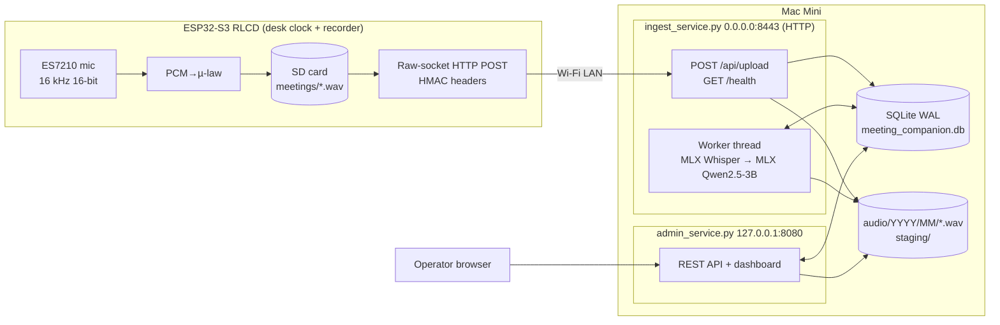
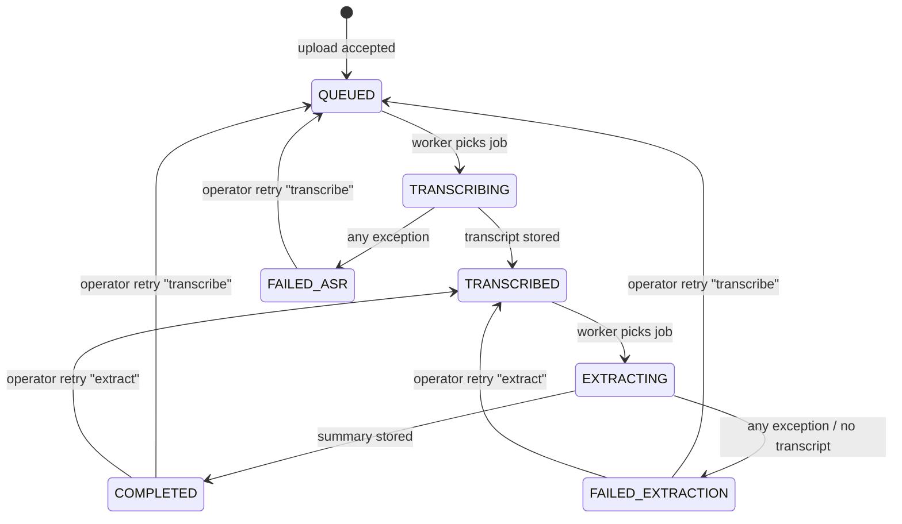

# **Meeting Companion — Plan v2.2 (as built, 2026-10-25)**

This version describes the system **as the code implements it today**: the ESP32-S3 firmware `Esp32-s3-rlcd-alex/Esp32-s3-rlcd-alex.ino` and the backend `backend/db.py`, `backend/ingest_service.py`, and `backend/admin_service.py`. It replaces `ImplementationPlan-V1.md` as the reference.

Each section has two parts:

* **As built:** what the code does now.
* **Gap vs v1:** what v1 specified that the code does not do yet. §21 lists these gaps as a prioritized roadmap.

Lessons from building v1 are in `docs/learned_lessons_v1.md`.

### **Changelog**

**v2.4.3 (2026-10-26): automated backend tests.** `backend/tests/` turns the §22 checks into 34 repeatable `unittest` tests that need no extra dependency (§22).

**v2.4.2 (2026-10-26):** documentation only. New §1.1 explains why the recorder is a dedicated device rather than a phone app.

**v2.4.1 (2026-10-25):** Bluetooth is explicitly off. `btStop()` runs in `setup()` and at record start. It was never started before this either, so this is a guard against future libraries, not a behavior change.

**v2.4 (2026-10-25): quiet recording.** While a recording runs, only the microphones are on (§18.2):

* **Internet off:** the radio is forced off, SNTP is stopped, and every Wi-Fi path refuses to run while recording.
* **Speaker off:** the ES8311 speaker DAC and its amplifier are now off on the Meeting screen. They used to be powered there even though nothing ever plays.
* **Sensors idle:** the SHTC3 sensor sleeps, and sensor and battery reads are refused while recording.
* **SHTC3 bug fixed:** a failed SHTC3 read (I2C or CRC error) used to return before sending the sensor back to sleep. It now always does.

**Still to check on the board:** a recording still captures sound after the speaker change. The serial log should show `Pending out channel for in channel running` when entering screen 2.

**v2.3 (2026-10-25): listen to recordings; audio is never deleted.**

* The dashboard has a **Listen** button on every job, and a player with **Download .wav** in the report.
* The audio route decodes µ-law to 16-bit PCM on the fly, so every browser can play it. It also returns 410 for a missing file (it used to return 500).
* The server no longer deletes a stored recording in any path. A verified upload whose DB insert fails is moved to `audio/orphans/` (§15.1).
* `numpy` is now a direct dependency.

**v2.2.4 (2026-10-25):** a duplicate of a `COMPLETED` job now returns `{job_id, status: "COMPLETED", duplicate: true}` (200). The response used to include the full extraction as `data`, sent over plain HTTP to a device that ignored it. The device classifies by status code, so its behavior is unchanged.

**v2.2.3 (2026-10-25): clock follows the UTC offset.** The RTC holds local time, but before this change it was rewritten only at boot, on a first-time network, and at 00:00. A new offset (a known network in another city, a DST change, or an Open-Meteo correction) left the displayed time wrong for up to a day. The comment "if city changed, sync time immediately" had no matching code, even in the original firmware. Now `rtc_gmt_offset` records the offset the RTC was last written with. After every localization or weather step, `resyncClockIfOffsetChanged()` runs NTP when the offset differs. `syncNTP()` updates `TZ` together with the RTC. Also in this change: string checks on the Wi-Fi network list are null-safe (ArduinoJson `==`), so a hand-edited entry with a non-string `essid` or `city` can no longer crash the device, and a leftover `.wav` literal was removed from the retention `sscanf`.

**v2.2.2 (2026-10-25): ArduinoJson 7.** The firmware moved from the deprecated v6 API to ArduinoJson 7.4.3. Each `DynamicJsonDocument(N)` became an elastic `JsonDocument`, `containsKey()` became `isNull()` checks, and `createNestedObject()` became `add<JsonObject>()`. Documents now grow on the heap as needed, so a large response no longer fails against a fixed capacity. One example: Open-Meteo's hourly arrays used to be parsed into a 12 KB document whose parse result was never checked.

**v2.2.1 (2026-10-25):** the upload's Wi-Fi power settings (no modem sleep, 8.5 dBm) are applied before the SHA-256 pass again, as in the original firmware. v2.1 had moved them after the hash, which left that long SD read at full TX power (§18.3).

**v2.2 (2026-10-25): filesystem as state machine.** The recording sidecar `.json` from v2.1 is gone. The filename now holds the recording's whole state: `YYYYMMDD_HHMMSS_<recording_id>_c<0|1>_<status>.wav`. The identity and clock flag are fixed when `fopen()` creates the file, and the status changes only through an atomic `rename()`. There is no RAM tracking and no second file that a brownout could leave half-written (§18.2). The `current_recording_*` globals were removed. No sidecar firmware had been flashed, so no migration is needed.

**v2.1 (2026-10-25): defect fixes.** The first v2 review found eight defects. All eight are now fixed:

| # | Defect | Fix | Where |
| ----- | ----- | ----- | ----- |
| 1 | A crash left jobs stuck in `TRANSCRIBING`/`EXTRACTING` forever | `recover_on_startup()` runs before the worker and listener: it deletes staging files, sweeps orphans, marks missing audio, and returns in-flight jobs (§16) | `db.py`, `ingest_service.py` |
| 2 | Re-transcription could summarize an old transcript | The worker sets `current_transcript_id`, and every read goes through `get_current_transcript()` (§8) | `db.py`, `ingest_service.py`, `admin_service.py` |
| 3 | Offline boot left the system clock near 1970, so uploads got 401 `clock_skew` | `seedSystemClockFromRTC()` at boot. `clock_valid` now comes from a flag set by a confirmed NTP sync (§18.5) | firmware |
| 4 | Retries of older files sent the latest recording's ID | The `recording_id` is stored with the file at recording start (since v2.2 in the filename) and read back on every retry. The server honors `X-Recording-Id` and returns `recording_conflict` when the digest differs (§6, §18.2) | firmware, `ingest_service.py` |
| 5 | Boot cleanup deleted unsent recordings after 48 h | Only `_OK` files expire (§15.2) | firmware |
| 6 | 409 duplicate was retried forever | The device parses the status code and `error_code`. 409 `duplicate` counts as uploaded, and permanent 4xx errors become `_rejected` (§18.4) | firmware, `ingest_service.py` |
| 7 | `_pending` files from a power loss were never uploaded | `recoverPendingRecordings()` rewrites the header from the file size at boot and queues the file as `_failed` (§18.2) | firmware |
| 8 | Werkzeug sent `100 Continue` before auth, so rejected requests still sent the whole body (confirmed by test) | `DeferredContinueRequestHandler` hides `Expect` from Werkzeug. The handler sends `100 Continue` only after every header check passes (§5) | `ingest_service.py` |

**v2.0 (2026-10-25):** first as-built description.

## **1. Objective**

A small backend on a Mac Mini (Apple Silicon) that:

* Accepts meeting recordings from an ESP32-S3 device (Waveshare ESP32-S3 RLCD 4.2).
* Streams the uploaded audio to local disk. The file is never held in RAM.
* Transcribes the audio locally with MLX Whisper.
* Summarizes the transcript locally with an MLX LLM (Qwen2.5-3B-Instruct, 4-bit).
* Keeps meeting history in SQLite.
* Serves a local admin REST API and an operator dashboard.

**Main change from v1:** the system is now **fully local at runtime**. v1 sent the transcript to Claude for structured extraction. The current code uses an on-device MLX LLM, and the backend makes no outbound calls. The `anthropic` package and `CLAUDE_API_KEY` are still in `requirements.txt` and `example.env`, but no code uses them (§10.2).

The device is also a desk clock. It shows a calendar, weather, local temperature and humidity, and battery level. The meeting recorder is one of its three screens (§18).

### **1.1 Why a dedicated device instead of a phone app**

A phone is the more capable platform: better microphones and battery, and no hardware to buy. The dedicated device was chosen anyway, for two reasons:

* **Learning:** hands-on practice with embedded hardware and an edge-to-local AI pipeline was an explicit goal of the project.
* **A different product:** a single-purpose companion that lives on the desk.

| | Phone app | Dedicated desk device |
| ----- | ----- | ----- |
| Hardware already owned | Yes | No |
| Microphones, battery, connectivity | Better | Adequate for speech (16 kHz µ-law) |
| Start a recording | Unlock, open the app, dismiss notifications | One physical button on the Meeting screen (§18.1) |
| No network | Depends on the app | Records to SD; the file waits as `_failed` until the Mini is reachable (§18.2) |
| Moving the file to the transcriber | Often manual: share, upload, copy | Automatic signed upload when recording stops, retried later (§18.3) |
| During the meeting | A personal device on the table | Radio, speaker and sensors off; only the microphones run (§18.2) |
| Development effort | Lower | Higher |

**Limits of the device today:**
* `_failed` uploads are retried only after the next successful upload, not on a timer (§21, P0-1).
* The device has not been validated on the board since the v2 changes (§22).

**Not a dead end:** the ingest API is a plain HTTP upload with an HMAC signature (§6) and doesn't depend on the device. A phone app could use the same backend unchanged.

## **2. Scope**

### **2.1 As built**

* LAN only. One Mac Mini, one device (seeded from `.env`). The schema supports more than one device.
* Completed-file upload. The device records to SD, computes SHA-256 of the finished file, and then streams the file in one HTTP POST.
* Audio format: WAV G.711 µ-law (format tag 7), 8-bit, mono, 16 kHz. The device converts 16-bit PCM to µ-law as it records.
* Two Flask processes: an **ingest service** (with the processing worker thread inside it) and an **admin service**.
* SQLite is the system of record and the job queue.
* One background worker thread runs ASR, then summarization, one job at a time.
* A minimal operator dashboard: job list, state badges, retry, and a report modal with the summary and transcript.

### **2.2 Not built yet (v1 scope still open)**

* Structured extraction (decisions, action items, commitments, risks, follow-ups, speakers).
* Full-text search (the FTS5 table exists but nothing writes to it).
* Participant directory UI, speaker mapping, item status tracking.
* Leases, heartbeats, automatic retries with backoff. (Startup crash recovery is built, §16.)
* Replay protection, rate limits, WAV validation, size and duration limits.
* TLS on the ingest listener.
* Retention jobs on the backend, and backups.

Still out of scope, as in v1: vector search/RAG, Slack/email, calendar, cloud backup, PostgreSQL, audio diarization, public ingest, resumable chunked upload.

## **3. Requirements**

**Mac Mini backend** (`backend/README.md`):

* System: Python 3.12, `sqlite3`, `ffmpeg`. `mlx-whisper` uses ffmpeg to decode the µ-law WAV.
* Python (`backend/requirements.txt`): `flask>=3.0.0`, `mlx>=0.32.4`, `mlx-lm>=0.32.4`, `mlx-whisper>=0.4.3`, `python-dotenv>=1.0.0`, `requests>=2.31.0`.
* No code imports these listed packages yet: `anthropic`, `flask-cors`, `requests`.
* Models are downloaded from Hugging Face on first run: `mlx-community/whisper-turbo` and `mlx-community/Qwen2.5-3B-Instruct-4bit`.
  * The README says to accept the license for `meta-llama/Llama-3.2-3B-Instruct` and set `HF_TOKEN`. The code does not use Llama. The Qwen model is not gated, so this README step is out of date.

**Environment (`backend/.env`, from `example.env`):**

| Variable | Use |
| ----- | ----- |
| `ESP32_UUID` | Device ID registered at startup |
| `ESP32_SECRET` | HMAC shared secret for that device |
| `INGEST_PORT` | Ingest listener port (default 8443) |
| `ADMIN_PORT` | Admin listener port (default 8080) |
| `CLAUDE_API_KEY` | Not used |

**ESP32-S3 firmware (Arduino IDE 2.3.x):**

* `arduino-esp32` core 3.x. The firmware uses the ESP-IDF `i2c_master` driver, `esp_codec_dev`, `esp_qrcode`, and `mbedtls`.
* Libraries: `Adafruit_GFX`, `U8g2_for_Adafruit_GFX`, and `ArduinoJson` 7.x (7.4.3). The code uses the v7 API: elastic `JsonDocument`, `isNull()` checks, `add<JsonObject>()`. It does not build against 6.x.
* Bundled with the core: `WiFi`, `WebServer`, `DNSServer`, `HTTPClient`.
* Local board-support files: `display_bsp`, `i2c_bsp`, `codec_bsp`, `sdcard_bsp`, `PCF85063A`, `font.h`, and `src/ExternLib`.

**SD card files (device):**

| File | Keys / content |
| ----- | ----- |
| `config_wifi.txt` | `wifi_ssid`, `wifi_pass` (the default network) |
| `config_clock.txt` | `city`, `latitude`, `longitude`, `gmt`, `override` (`true` = use the file's location, not the network database) |
| `config_server.txt` | `mac_server` (e.g. `http://192.168.1.100:8443`), `device_id`, `key_id`, `hmac_secret` |
| `wifi_database.json` | Array of `{essid, password, city, latitude, longitude, gmt}`, one entry per known network |
| `meetings/YYYYMMDD_HHMMSS_<recording_id>_c<0|1>_<status>.wav` | Recordings. The name holds the identity, the clock flag, and the upload status (§18.2) |

`key_id` in `config_server.txt` must be `primary-key-01`. The backend hard-codes this key ID when it seeds the device (§6.3).

## **4. Architecture**



### **4.1 As built**

* There are **two OS processes**, started by hand: `python3.12 ingest_service.py` and `python3.12 admin_service.py`. Both must run from `backend/`, because `DB_PATH`, `audio/`, and `staging/` are relative paths.
* Both processes call `init_db()` at import, so migrations and device seeding run in each one.
* The ingest process first runs `recover_on_startup()` (§16). Then it starts one daemon **worker thread**, `process_background_tasks`. The thread loads both MLX models once and then polls SQLite every 3 seconds.
* The admin process does **not** run recovery. It can restart while the worker is busy, and it must not hand that job back to the queue.
* Both processes use the Flask development server (Werkzeug). `threaded=True` is the default. The ingest process passes `request_handler=DeferredContinueRequestHandler` (§5.1).
* A job is one row in `meetings`. Pending work is rows in `meetings`.
* An upload never waits for ASR or summarization.

### **4.2 Gap vs v1**

* ASR does not run in a child process. A native crash in MLX/Metal stops the whole ingest process, including the upload listener.
* There is no supervisor, launchd job, or production WSGI server.

## **5. Upload Acceptance and Durability**

### **5.1 As built — order of operations (`POST /api/upload`)**

Authentication runs first, in the `require_device_hmac` decorator:

1. Require `X-Device-Id`, `X-Key-Id`, `X-Request-Timestamp`, `X-Signature` → else 401 `unauthorized`.
2. `X-Request-Timestamp` must be an integer → else 400 `bad_request`.
3. `|now − timestamp| ≤ 300 s` → else 401 `clock_skew`.
4. Look up `device_keys` by `(device_id, key_id)` with `revoked_at IS NULL` → else 401 `unknown_key`.
5. Recompute the HMAC (§6.2) and compare in constant time → else 401 `bad_signature`.

Then the handler:

6. `Content-Length` present → else 411. (A missing length already fails the signature in step 5, because the signed string includes it.)
7. `Content-Type == audio/wav` → else 415.
8. `X-Recording-Started-At` present → else 400.
9. Resolve `recording_id` (§6.1):
   * `X-Recording-Id` present: it must parse as a UUID → else 400 `invalid_headers`.
   * Absent (legacy file): use `"{device_id}_{recording_started_at}"`.
10. Look up `meetings` by `(device_id, recording_id)`, and respond per §6.5 when a row exists. The body is not read.
11. **Send `100 Continue`** if the client asked for it. Until this step, nothing has invited the client to send the body.
12. Generate `job_id` (UUIDv4). Stream `request.stream` in 8 KiB chunks to `staging/{job_id}.part`, and compute SHA-256 while writing.
13. If the client sent `X-Content-SHA256` and it differs from the computed digest → delete the staging file and return 400 `hash_mismatch`.
14. `os.rename` the staging file to `audio/{yyyy}/{mm}/{job_id}.wav`. `yyyy/mm` come from the server's UTC time.
15. INSERT the `meetings` row with state `QUEUED`, including `clock_valid` from `X-Clock-Valid`. `uploaded_at` comes from the device's `X-Request-Timestamp`. If the insert fails → move the audio file to `audio/orphans/` (never delete it) and return 500.
16. Return 202 `{job_id, status: "QUEUED", duplicate: false}`.

The DB connection stays closed while the body streams, so slow network I/O never holds a SQLite lock.

**Expect: 100-continue.** Werkzeug 3.1 writes `100 Continue` inside `WSGIRequestHandler.run_wsgi()`, before the app runs. This was confirmed by a socket test: a request that fails auth received `100 Continue` and then the 401. `DeferredContinueRequestHandler` deletes the `Expect` header before calling `run_wsgi()`, and records it in the environ (`meeting_companion.expect_100`). The handler then writes `100 Continue` to `environ["werkzeug.socket"]` at step 11. The test also confirmed the results: rejected requests (401, duplicate 202, 409) now get the final status with no `100`, and accepted ones get `100` first.

### **5.2 Crash windows (as built)**

| Process stops | State on disk | What happens today | Client retry |
| ----- | ----- | ----- | ----- |
| During body stream | `staging/*.part` | Startup recovery deletes it | A new job is created |
| After rename, before INSERT commits | Audio file, no row | Startup recovery moves it to `audio/orphans/` | A new job is created |
| After commit, before 202 is sent | Row and file | None | Gets a duplicate response (§6.5) |

### **5.3 Gap vs v1**

* No `F_FULLFSYNC` on the staging file or directories. The order "INSERT in a transaction, rename, fsync, COMMIT" is not used: the code renames first, then inserts.
* Early rejection now covers auth and duplicates. The other headers-only checks (409 `upload_in_progress`, 413, 429, 507) still do not exist.
* No WAV header parsing or validation (format, channels, sizes, duration), and no minimum or maximum duration.
* No check that the bytes received equal `Content-Length`.
* No recording of `audio_duration_s` or `sample_rate`.

## **6. Identity, Authentication, Replay, and Duplicates**

### **6.1 Identifiers (as built)**

| Identifier | Device side | Server side |
| ----- | ----- | ----- |
| `device_id` | From `config_server.txt` | Must exist in `devices`/`device_keys` |
| `key_id` | From `config_server.txt` | Seeded as `primary-key-01` |
| `request_id` | New UUIDv4 per attempt (`X-Request-Id`) | **Ignored** |
| `recording_id` | UUIDv4 made at recording start, embedded in the filename, sent as `X-Recording-Id` | Used when present (must be a UUID). Legacy fallback: `{device_id}_{X-Recording-Started-At}` |
| `recording_started_at` | The filename timestamp (RTC local time) converted with `mktime` | Stored. Part of the legacy `recording_id` |
| `clock_valid` | The filename flag `c1`/`c0`: 1 if a confirmed NTP sync happened since boot. Legacy names: 0 | Stored in `meetings.clock_valid` |
| `request_timestamp` | `time(NULL)`, seeded from the RTC at boot and corrected by NTP | Checked to ±300 s, and used as `uploaded_at` |
| `job_id` | — | UUIDv4 (v1 asked for v7) |

**Legacy files.** Recordings made before v2.1 are named `YYYYMMDD_HHMMSS_<status>.wav` and carry no ID. The device omits `X-Recording-Id` for them, so they keep the identity they had before. A failed upload that is retried after the firmware update therefore still deduplicates against any row the server already has.

### **6.2 Signed canonical string (as built — "v0", 5 fields)**

```
{device_id}
{key_id}
{request_timestamp}
{content_sha256}
{content_length}
```

* UTF-8, fields joined by `\n`, no trailing newline.
* `X-Signature = lowercase hex(HMAC-SHA256(secret, canonical))`.
* Device: `computeHMACSHA256()` with mbedtls. Server: `hmac.new(...)` and `hmac.compare_digest`.
* The device does not send `X-Sig-Version`, and the server does not check for it.

**Gap vs v1:** the v1 12-field string (with version, method, path, request_id, recording_id, recording_started_at, clock_valid, content_type) is not used. Today these headers are **not covered by the signature**: `X-Recording-Started-At`, `X-Request-Id`, `X-Recording-Id`, `X-Clock-Valid`, `Content-Type`. Someone who replays a captured request inside the 300 s window can change `X-Recording-Id` or `X-Recording-Started-At` and create a second job. Signing `X-Recording-Id` matters more now that the server uses it. There are no shared test vectors.

### **6.3 Keys (as built)**

* On startup, `register_env_device()` runs `INSERT OR IGNORE` with the device from `ESP32_UUID`/`ESP32_SECRET`, using `key_id = primary-key-01`, `not_before = now`, and `not_after = now + 10 years`.
* `INSERT OR IGNORE` does not update an existing row. If you change `ESP32_SECRET` in `.env` after the first run, the database keeps the old secret.
* The auth check uses only `revoked_at IS NULL`. It ignores `not_before`/`not_after`.
* Secrets are stored in plaintext: in SQLite on the Mini, and in `config_server.txt` on the device SD card.

**Gap vs v1:** no `meetingctl` CLI (device add, key rotate, key revoke). No encrypted NVS or flash encryption on the ESP32. No 0600 file-mode enforcement.

### **6.4 Replay (as built)**

None. The `replay_nonces` table exists, but nothing reads or writes it. The ±300 s timestamp window is the only replay limit.

### **6.5 Duplicate recordings (as built)**

The lookup is `SELECT * FROM meetings WHERE device_id = ? AND recording_id = ?`, which matches the schema's unique key. It runs **before** the body is read.

| Existing row | HTTP | Body |
| ----- | ----- | ----- |
| Any state, and `X-Content-SHA256` ≠ stored `audio_sha256` | 409 | `{error_code: "recording_conflict", job_id, message}` |
| `COMPLETED` | **200** | `{job_id, status: "COMPLETED", duplicate: true}`. No meeting content |
| `FAILED_ASR`, `FAILED_EXTRACTION` | 409 | `{job_id, status, duplicate: true, error_code: "duplicate", last_error_code}` |
| `QUEUED`, `TRANSCRIBING`, `TRANSCRIBED`, `EXTRACTING` | 202 | `{job_id, status, duplicate: true}` |

* A conflict is logged as `[UPLOAD] Recording conflict …`. It is not shown on the dashboard yet.
* There is no `upload_in_progress` guard. Two concurrent uploads of one recording can both pass the check, and the second INSERT then fails the UNIQUE constraint with a 500.

### **6.6 Rate limits**

Not implemented.

### **6.7 Listeners and admin authentication (as built)**

* Ingest: `0.0.0.0:INGEST_PORT` (8443), **plain HTTP** (the port number suggests TLS, but there is none). Routes: `POST /api/upload` and `GET /health`.
* Admin: `127.0.0.1:ADMIN_PORT` (8080).
* Admin auth (`require_admin_auth`) accepts **any** `Authorization: Bearer …` value and **any** `session` cookie. The hard-coded `dev-admin-token` is embedded in the dashboard JavaScript. The `/` and `/dashboard` pages themselves need no auth.
* The `admins` and `api_tokens` tables exist but are not used.

Because of this, the localhost bind is the **only** admin protection today.

## **7. Ingestion**

### **7.1 Accepted audio (as built)**

* `Content-Type` must be exactly `audio/wav`. The body is not inspected.
* In practice, the only producer is the device: RIFF/WAVE, `fmt` chunk of 16 bytes, format tag 7 (µ-law), 1 channel, 16000 Hz, byte rate 16000, block align 1, 8 bits per sample, 44-byte header.
* Whisper decodes the file with the ffmpeg CLI (`mlx_whisper.audio.load_audio`; soundfile is never used), so any format ffmpeg can read gets transcribed.
* **µ-law verified (2026-10-25):** the Mini holds 6 real µ-law device uploads, between 10 s and 190 s long. All are `COMPLETED`, with coherent English transcripts at 87–170 words/min (the 190 s one has 538 words), and there are no repetition loops. Switching back to 16-bit PCM is not needed, and it would double the SD write rate that caused the original timeouts.

### **7.2 Limits**

None (no max or min duration, no max Content-Length, no read timeouts beyond Werkzeug's defaults).

Sizing: µ-law at 16 kHz is **16,000 bytes/s ≈ 57.6 MB per audio hour**. That is half of v1's 16-bit estimate.

### **7.3 Response codes (as built)**

| HTTP | `error_code` | When |
| ----- | ----- | ----- |
| 200 | — | Duplicate of a `COMPLETED` job |
| 202 | — | Accepted, or duplicate of an in-progress job |
| 400 | `bad_request`, `invalid_headers`, `hash_mismatch` | Bad timestamp, missing `X-Recording-Started-At`, non-UUID `X-Recording-Id`, digest mismatch |
| 401 | `unauthorized`, `clock_skew`, `unknown_key`, `bad_signature` | Authentication failed |
| 409 | `duplicate`, `recording_conflict` | Duplicate of a failed job; different file under an existing `recording_id` |
| 411 | `length_required` | No `Content-Length` (in practice it fails at 401 first) |
| 415 | `unsupported_media` | Content-Type is not `audio/wav` |
| 499 | `incomplete_body` | The device closed the connection before sending `Content-Length` bytes (SD read or Wi-Fi write failure). Nothing is kept. 499 is nginx's "Client Closed Request"; the device rarely reads it, since it already hung up |
| 500 | `internal` | Stream read error, or DB insert error (including the duplicate race) |

Error body: `{error_code, message}`. `request_id` is not echoed.

## **8. State Machine**

### **8.1 As built**



Worker loop (`process_background_tasks`), every 3 seconds:

1. `SELECT … WHERE state='QUEUED' LIMIT 1`, then `UPDATE … SET state='TRANSCRIBING'`. These are two statements with no state guard and no ordering.
2. `mlx_whisper.transcribe(audio_path, path_or_hf_repo="mlx-community/whisper-turbo", fp16=True)`.
3. INSERT into `transcripts` (`asr_runtime`, `asr_model`, `text`). Set state to `TRANSCRIBED`, `current_transcript_id` to the new row, and `transcribed_at`. Older transcripts stay for audit.
4. `SELECT … WHERE state='TRANSCRIBED' LIMIT 1`, then set state to `EXTRACTING`. Read the transcript with `get_current_transcript()`: it returns the row that `current_transcript_id` points to, or the newest row for a legacy job where the pointer is null.
5. Generate the summary with the LLM (§10.2). INSERT into `extractions` (`transcript_id`, `model='mlx-llm'`, `summary`, `raw_json={"summary": …}`). Set state to `COMPLETED`, with `current_extraction_id` and `completed_at`.
6. On any exception: set the state to `FAILED_*` and fill `last_error_message`.

Operator retry (`POST /api/jobs/{id}/retry`, body `{stage}`):

* `transcribe`: allowed from `FAILED_ASR`, `FAILED_EXTRACTION`, `COMPLETED`. The audio file must exist (else 410). It sets `QUEUED` and `attempts_asr=0`.
* `extract`: allowed from `FAILED_EXTRACTION`, `COMPLETED`. It sets `TRANSCRIBED` and `attempts_extract=0`.
* Any other state → 409 `invalid_state`. A bad stage → 400.

### **8.2 Remaining limits of the as-built loop**

* Fixed in v2.1: stuck jobs after a crash (startup recovery, §16), and the wrong transcript after re-transcription (step 4).
* A job stuck **while the process is still running** (for example an MLX hang) is not recovered. Only a restart returns it to the queue, because there are no leases.
* No attempt counting (`attempts_*` are reset but never incremented), no backoff, and `next_attempt_at` is unused. Worker failures do not set `last_error_code`/`last_error_at`. Recovery does set them for `audio_missing`.
* `progress` is never updated.

### **8.3 Gap vs v1**

Atomic claim with `RETURNING`, lease token and fencing, a 15 s heartbeat, the reaper, the ASR child process with a timeout, the retry policy (§8.2 of v1), and the `confirm_discard_edits` guard.

## **9. Processing Pipeline**

### **9.1 As built**

* Upload → `QUEUED`.
* ASR: Whisper decodes the WAV through ffmpeg (µ-law at 16 kHz goes straight in, with no resampling). One call over the whole file, with default decoding options. Only the full `text` is stored.
* Summary: a single free-text prompt over the whole transcript, `max_tokens=1024`.

### **9.2 Gap vs v1**

* No VAD, no `language` setting, no `condition_on_previous_text=False`, no segments with timestamps (`transcript_segments` stays empty), no progress reporting.
* No schema-validated structured output.

## **10. AI**

### **10.1 ASR (as built)**

* Runtime: `mlx-whisper`, in process.
* Model: `mlx-community/whisper-turbo` (large-v3-turbo), `fp16=True`, hard-coded.
* Language: auto-detected. `devices.default_language` (seeded as `en`) is not passed through.
* Stored metadata: `asr_runtime='mlx-whisper'`, `asr_model`. `language` and `params_json` are not filled.

### **10.2 Summarization (as built) — replaces Claude extraction**

* Runtime: `mlx-lm`, model `mlx-community/Qwen2.5-3B-Instruct-4bit`, loaded once into unified memory at worker start.
* Prompt: `"Summarize the following meeting transcript, identify key speakers, and extract actionable items:\n\n{transcript}"`, wrapped with the tokenizer's chat template.
* Output: free text, stored in `extractions.summary`, and also stored as `raw_json = {"summary": text}`.
* `model` is stored as the literal `"mlx-llm"`, not the model ID. `prompt_version`, `schema_version`, and the token counts are not filled.
* No token budget check. A long meeting can exceed the model's context window, and the generation can stop at 1024 tokens with no error.

**Decision recorded:** extraction is local-first. Moving to Claude (as v1 planned) or to a larger local model is a v2.x choice (§21, D6). The v1 extraction schema (§10.3 of v1) is still the target contract, whichever model produces it.

### **10.3 Speakers and participants**

The tables exist: `speakers`, `participants`, `meeting_participants`.

* Nothing fills `speakers`.
* `meeting_participants` is only read, by the participant summary endpoint.
* Participants can be created and listed through the API.

### **10.4 Privacy boundary (as built)**

Audio, transcripts, and summaries never leave the Mini. The only outbound traffic is the one-time model download from Hugging Face.

The **device** does make outbound calls for its clock features: mylnikov.org (Wi-Fi geolocation by BSSID), ip-api.com, bigdatacloud.net, open-meteo.com, and NTP pools. Meeting audio never goes anywhere except the Mini.

## **11. Database**

### **11.1 As built**

* One SQLite file, `meeting_companion.db`, relative to the working directory.
* Every connection sets: `journal_mode=WAL`, `synchronous=FULL`, `fullfsync=ON`, `busy_timeout=5000`, `foreign_keys=ON`.
* Migrations: a `MIGRATIONS` list in `db.py`, tracked in `schema_migrations(version, applied_at)`. Version 1 creates every v1 table, including `search_fts` (FTS5, `unicode61 remove_diacritics 2`). There is no pre-migration backup.

Tables and their actual use:

| Table | Written by code | Notes |
| ----- | ----- | ----- |
| `devices`, `device_keys` | Startup seed | `default_language`, `last_seen_at`, `disabled_at` unused |
| `replay_nonces` | — | Unused |
| `meetings` | Ingest, worker, retry, recovery | See §5, §8 for unused columns |
| `transcripts` | Worker | Only `job_id`, `asr_runtime`, `asr_model`, `text` |
| `transcript_segments` | — | Empty |
| `extractions` | Worker | Only `job_id`, `transcript_id`, `model`, `summary`, `raw_json` |
| `speakers`, `action_items`, `commitments`, `decisions`, `risks`, `follow_ups` | — | Empty |
| `participants` | `POST /api/participants` | name, email |
| `meeting_participants` | — | Read only |
| `admins`, `api_tokens` | — | Unused |
| `search_fts` | — | Empty |

### **11.2 Gap vs v1**

* `meetings.current_transcript_id` and `current_extraction_id` have no FK constraints. The code maintains both pointers, but the schema does not enforce them.
* `meetings.device_id` has no FK.
* No INDEX on `(state, next_attempt_at)`.
* FTS writes, search, and the delete cascade are not implemented.

## **12. HTTP API**

### **12.1 Ingest listener — `http://{mini-lan-address}:8443`**

| Route | Status |
| ----- | ----- |
| `POST /api/upload` | Built (§5) |
| `GET /health` | Built, returns `{status: "ok"}` |

### **12.2 Admin listener — `http://127.0.0.1:8080`**

| Route | Status | Notes |
| ----- | ----- | ----- |
| `GET /health` | Built | No auth |
| `GET /`, `GET /dashboard` | Built | No auth. Inline HTML/JS |
| `GET /api/jobs` | Built | Filter: `state`. No pagination |
| `GET /api/jobs/{id}` | Built | Full row |
| `POST /api/jobs/{id}/retry` | Built | `stage` only. No `confirm_discard_edits` |
| `GET /api/meetings` | Built | No filters, no pagination |
| `GET /api/meetings/{id}` | Built | Includes `extraction`, `speakers`, and the full text of the **current** transcript. v1 said no transcript here |
| `GET /api/meetings/{id}/audio` | Built | 16-bit PCM: `send_file` (Range requests work). **µ-law: streamed as 16-bit PCM WAV, decoded on the fly** (no Range), because browser support for µ-law WAV varies. The decoder matches ffmpeg byte-for-byte on all real uploads, and the stored file is never modified. 404 unknown job; 410 `audio_missing` when the path is null or the file is gone |
| `GET /api/participants` | Built | Excludes archived |
| `POST /api/participants` | Built | name, email. No validation |
| `GET /api/participants/{id}/summary` | Partial | Attended meetings only |
| `GET /api/ops/summary` | Partial | State counts only |
| `PATCH`/`DELETE /api/meetings/{id}` | Missing | |
| `GET /api/meetings/{id}/transcript` | Missing | |
| `PUT /api/meetings/{id}/speakers/{sid}`, `PUT …/participants` | Missing | |
| `PATCH /api/items/{kind}/{id}` | Missing | |
| `GET /api/search` | Missing | |
| `PATCH`/`DELETE /api/participants/{id}` | Missing | |
| `GET /api/devices` | Missing | |
| `POST /api/ops/extraction/resume` | Missing | Not needed while extraction is local |

## **13. Dashboard**

### **13.1 As built (`DASHBOARD_HTML` in `admin_service.py`)**

* Ops summary card: the `/api/ops/summary` JSON shown as is.
* Job table: short job ID, device, state badge, upload time (shown in the browser's time zone, with UTC assumed when no offset is given), a **Retry** button (always `stage: transcribe`), a **Listen** button on every job, and **View Report** on `COMPLETED` jobs.
* Report modal: the recording (player + **Download .wav**), then the summary and the full transcript, set with `innerText`.
* Audio modal (**Listen**): the player and download link, for a job in any state. The recording exists as soon as the upload is accepted.
* Playback: `<audio src>` cannot send the `Authorization` header, so the page fetches the recording with it and plays a blob URL. One recording is held in browser memory at a time (about 115 MB per hour once decoded). It is released when the modal closes.
* Auto-refresh every 10 s.

### **13.2 Gap vs v1**

* Meeting filters, item lists with evidence links, transcript with timestamps and an audio player, speaker mapping, search, participant pages, and operator metrics are all missing.
* Security: the job table builds rows with `innerHTML` from `device_id` and `state`. No Content-Security-Policy is sent. The bearer token is in the page source.

## **14. Concurrency and Backpressure (as built)**

| Setting | Value |
| ----- | ----- |
| ASR + summary workers | 1 thread, sequential, in the ingest process |
| Concurrent uploads | Unbounded (Werkzeug threaded server) |
| Free-disk watermark | None |
| Max queued jobs | None |

Worker priority: in each loop, one QUEUED job is transcribed, then one TRANSCRIBED job is summarized. Uploads are never blocked by the worker.

## **15. Retention and Storage**

### **15.1 Backend (as built)**

**Policy: the server never deletes stored audio.** This decides v1's D4 and replaces v1's plan of deleting `COMPLETED` audio after 90 days.

* Every accepted recording under `audio/`, and every file in `audio/orphans/`, is kept until an operator removes it by hand. No endpoint, job, or recovery step deletes it.
* A verified upload whose DB insert fails is **moved** to `audio/orphans/` (it used to be deleted). Startup recovery also moves unregistered files there.
* The only files the services remove are in `staging/`: partial bodies and bodies that failed the digest check. These are incomplete uploads that the device retries, not stored recordings.
* Plan disk for keeping everything: at µ-law, 8 audio hours/day is about 170 GB per year. Disk monitoring (the v1 507 watermark) matters more under this policy, and is still open (§5.3).

Sizing at µ-law: 57.6 MB per audio hour. 8 audio hours/day for 90 days ≈ **41.5 GB**.

### **15.2 Device (as built)**

* `cleanOldRecordings()` runs **at boot only**. It deletes `_OK.wav` files whose filename timestamp is more than 48 h old.
* `_failed`, `_pending`, and `_rejected` files are never deleted automatically. The user must clear `_rejected` files by hand (§18.4).
* SD space is not monitored. A device that cannot reach the Mini for a long time fills the card.

## **16. Recovery**

### **16.1 As built**

On import, both services run `init_db()`. This creates `staging/`, `audio/`, and `audio/orphans/`, applies migrations, and seeds the device.

Then the ingest service, in `__main__`, runs `recover_on_startup()` (`db.py`) **before** it starts the worker thread and opens the listener:

1. Delete every file in `staging/`. No upload survives a restart.
2. Orphan sweep: move each `.wav` under `audio/` (except `audio/orphans/`) that no `meetings.audio_relpath` points to into `audio/orphans/`. Orphans are never deleted, because a database restored from backup can be older than the audio.
3. Missing-audio check: a `QUEUED` or `TRANSCRIBING` row whose file is missing → `FAILED_ASR`, `last_error_code = audio_missing`.
4. Return in-flight jobs: `TRANSCRIBING` → `QUEUED`, `EXTRACTING` → `TRANSCRIBED`. No attempt is counted (attempts are not counted anywhere yet).
5. `COMPLETED` and `FAILED_*` rows are left unchanged.

Verified on a scratch database. A staging file, an orphan, a `TRANSCRIBING` job, an `EXTRACTING` job, and a `QUEUED` job with no file ended as: staging empty, orphan moved, `QUEUED`, `TRANSCRIBED`, and `FAILED_ASR audio_missing`.

### **16.2 Gap vs v1**

* No pre-migration database backup.
* Step 4 is safe only while the ingest process hosts the only worker. If workers move to another process, use leases instead.

## **17. Deployment and Network**

### **17.1 As built**

* Run by hand from a terminal with the venv active (`backend/README.md`). There is no launchd job.
* Ingest binds to `0.0.0.0` over HTTP. Admin binds to `127.0.0.1`.
* The device reaches the Mini at the address in `config_server.txt` (`mac_server`). Give the Mini a DHCP reservation.

### **17.2 Gap vs v1**

* No launchd LaunchAgent (KeepAlive, RunAtLoad).
* No `pmset sleep 0 disksleep 0 autorestart 1`, no UPS.
* No TLS with a private CA pinned on the device.
* No firewall rule.
* No secrets in the Keychain.

## **18. Device Contract (ESP32) — as built**

### **18.1 Screens and buttons**

| Screen | Content | Wi-Fi | CPU |
| ----- | ----- | ----- | ----- |
| 1 Clock | Time, calendar, weather, local SHTC3 temp/RH, battery %, last IP | Off except during sync | 80 MHz + light sleep to the next minute |
| 2 Meeting | Status, record indicator and timer, last file, SD error dialog | Tested on entry, then off. **Forced off for the whole recording.** On after stop, for upload | 160 MHz, ES7210 mics on. **ES8311 speaker DAC and amplifier off** |
| 3 Config | QR code for an open SoftAP, captive DNS, web form at `192.168.5.1` | AP mode | 160 MHz |

* Left button (GPIO18) cycles 1 → 2 → 1. From screen 2 it goes to screen 3 instead, but only when the Wi-Fi check on entering screen 2 failed.
* Right button (GPIO0/BOOT) starts and stops recording on screen 2.
* Leaving screen 2 while recording stops the recording and uploads it. Leaving also closes the ES7210/ES8311 codec and the I2S clocks, and turns off the PA.

### **18.2 Recording**

* **Filesystem as state machine:** each recording is one file, and its name is its whole state:
  ```
  /sdcard/meetings/YYYYMMDD_HHMMSS_<recording_id>_c<0|1>_<status>.wav
  e.g.  20261025_101500_3f2b8c1e-9a4d-4e2b-8f61-0c5d7a9e1b24_c1_pending.wav
  ```
  * `YYYYMMDD_HHMMSS`: RTC **local** time at start. The server turns it into `recording_started_at`.
  * `<recording_id>`: UUIDv4, generated when the file is created.
  * `c1`/`c0`: `clock_valid`, meaning a confirmed NTP sync since boot.
  * `<status>`: `pending` → `OK` | `failed` | `rejected`.
* The identity and the clock flag exist from the moment `fopen()` creates the file, and they never change. The status changes only through `rename()` (`withRecordingStatus()` replaces the text after the last `_`). FAT applies a rename atomically. There is no RAM tracking and no manifest or sidecar, so a battery cut or brownout cannot leave the state half-written. At worst, the file keeps its previous status.
* `parseRecordingIdentity()` reads the ID and flag back from the name. Legacy names (`YYYYMMDD_HHMMSS_<status>.wav`) return false. Names are about 85 characters, so FAT long filenames are required (the old 27-character names already needed them).
* The screen shows only `YYYYMMDD_HHMMSS (status)`.
* The firmware writes 44 zero bytes as a placeholder header, then reads frames: `CodecPort_EchoRead` 2048 bytes (1024 16-bit samples), converts them to 1024 µ-law bytes in place, and writes them with `fwrite`.
* On a write error or a short write: `sdCardError = true`, recording stops, and the SD error dialog shows (restart required).
* On stop: the firmware seeks to 0 and writes the real header (format 7, 8-bit, data size).
* **Power-loss repair:** at boot, `recoverPendingRecordings()` handles every `_pending.wav`:
  * 44 bytes or less → deleted (nothing was recorded).
  * Otherwise → header rewritten with data size = file size − 44, and the file renamed to `_failed.wav` so the next retry pass uploads it.
* **Quiet mode during recording:** only the microphones run. `enterRecordingQuietMode()` runs just before the first audio frame:
  * **Radios off:** it stops SNTP, forces `WIFI_OFF` unconditionally, and calls `btStop()`. Bluetooth is never used: the esp32 core frees its memory at boot because no BT library is linked, and `setup()` also calls `btStop()`. `ensureWiFiConnected()` refuses to run while `isRecording` is set, so no sync path can wake the radio. The upload starts only after the recording is stopped.
  * **Speaker off:** `silenceSpeaker()` closes the ES8311 output, which powers the DAC down, and the driver lowers the amplifier pin (`pa: 46` in `board_cfg.h`). The firmware never plays audio, so this applies to all of screen 2.
    * Both codecs share one full-duplex I2S port. While the mic (RX) is open, `esp_codec_dev` only marks the TX disable as pending, so the mic clocks keep running. Leaving screen 2 closes the mic, which then stops both.
    * The speaker is opened and immediately closed, rather than never opened. Opening only the mic would leave the TX channel enabled from `init_codec()`, and the I2S clocks would never stop.
  * **Sensors idle:** the SHTC3 is sent to sleep, and SHTC3 and battery-ADC reads are refused while recording. The battery shows its last value.
  * The PCF85063A RTC is still read once per second for the on-screen timer. It is the device's clock, not a sensor.
* There is no recording light. The on-screen "RECORDING..." indicator and timer are the only notice.

### **18.3 Upload (`streamFileToBackend`)**

1. Wi-Fi: `ensureWiFiConnected(6)` tries the default network, then scans for known networks in `wifi_database.json`.
2. `WiFi.setSleep(false)` and `WiFi.setTxPower(8.5 dBm)`, **before any SD read**: hashing reads the whole file, just like streaming does. Modem sleep off keeps the channel open (no dropped packets). Low TX power avoids 3.3 V brownouts while the SD card is being read. Both are restored on every exit path. These settings are required, so do not remove them or move them later in the function.
3. Compute SHA-256 of the file with mbedtls, using a 2 KiB heap buffer.
4. Parse `recording_id` and `clock_valid` from the filename, and compute `recording_started_at` from the filename timestamp with `mktime`. For a legacy name, the firmware omits `X-Recording-Id` and sends `clock_valid = 0`.
5. Build the 5-field HMAC (§6.2).
6. Open a raw `WiFiClient` to `host:port` from `mac_server` (default port 8443), with a 30 s timeout. Send the headers listed below.
7. Wait up to 5 s for a status line:
   * `100 Continue` → send the body.
   * Any other status → that is the **final** response (for example 401, 409, or a duplicate 202). The body is not sent.
   * No answer → send the body anyway.
8. Stream the file in 2 KiB chunks. Each write retries up to 20 × 50 ms. If the body does not go out completely, the attempt counts as a network error.
9. Wait up to 10 s for the final status line, skipping a late `100 Continue`. Read the headers and up to 512 bytes of the body, and parse `error_code` from the JSON.

Headers sent: `Content-Type: audio/wav`, `Content-Length`, `Expect: 100-continue`, `X-Device-Id`, `X-Key-Id`, `X-Request-Id`, `X-Recording-Id` (omitted for legacy names), `X-Recording-Started-At`, `X-Clock-Valid`, `X-Request-Timestamp`, `X-Content-SHA256`, `X-Signature`, `Connection: close`.

### **18.4 Response handling and retries (as built)**

`classifyUploadResponse()` maps each response to an `UploadResult`. Then `uploadRecordingFile()` renames the file by outcome:

| Response | Result | File | Screen |
| ----- | ----- | ----- | ----- |
| 200, 202, or 409 `duplicate` | `UPLOAD_OK` | `_OK.wav` | "Saved & Transmitted!" |
| 401 `clock_skew` | `UPLOAD_CLOCK_SKEW` → `syncNTP()` and **one** retry. If the sync fails, the file is kept for a later retry | per the retry's result | — |
| 400 `hash_mismatch`, 408, 409 (other codes), 429, 5xx, 507, timeout, no status | `UPLOAD_RETRY_LATER` | `_failed.wav` | "Upload Failed (will retry)" |
| 409 `recording_conflict`, other 4xx (400, 401, 411, 413, 415…) | `UPLOAD_REJECTED` | `_rejected.wav` (kept, never retried, never deleted) | "Rejected by server (kept)" |
| No Wi-Fi | — | `_failed.wav` | "Saved to SD (Offline)" |

* After a successful upload, `processFailedUploads()` lists every `_failed.wav` first, then uploads each one through the same path. It does not rename files while `readdir()` is still walking the directory.
* Failed files are still retried **only** after a later recording uploads successfully. There is no timer-based retry and no backoff (§21).

### **18.5 Time, network, and localization**

* **Clock:** the PCF85063A RTC holds **local** time. NTP (`configTime(gmt_offset*3600)`) sets both the system clock and the RTC, but only after a confirmed SNTP callback. It runs at boot, daily at 00:00, and after a 401 `clock_skew`.
* **Offset changes:** `rtc_gmt_offset` is the offset the RTC's local time was written with, and the active `TZ`. After localization or a weather update, `resyncClockIfOffsetChanged()` runs `syncNTP()` when `gmt_offset` differs. That call rewrites the RTC and `TZ` together. If the sync fails, the next sync minute retries. `TZ` is never changed on its own: filename timestamps are RTC local time, so converting them with a new offset before the RTC is rewritten would shift `recording_started_at`.
* **System clock seeding:** at boot, right after the SD configs load, `seedSystemClockFromRTC()` runs:
  * It sets `TZ` from `gmt_offset` (POSIX form, so GMT-5 becomes `UTC+5`).
  * It converts the RTC's local time with `mktime` and calls `settimeofday`.
  * It skips this when the RTC year is before 2024 (RTC never set).

  So `time(NULL)`, the request timestamps, and the 48 h cleanup are correct without internet. The result is only as accurate as the RTC and the stored offset.
* **`clock_valid`:** `clockSyncedSinceBoot` is set by a confirmed NTP sync. A recording gets `clock_valid = 1` when NTP has synced since boot. The value is stored in its filename (`c1`).
* **Weather:** Open-Meteo at minutes :02, :17, :32, :47. It also runs when the network changes. When offline, it retries every minute for 3 minutes, then only on the sync minutes. The GMT offset comes from `utc_offset_seconds`.
* **Localization:** with `override=true` the firmware uses `config_clock.txt`. Otherwise it uses the `wifi_database.json` entry for the current SSID.
  * On first connection to a new SSID, it runs: WPS geolocation → IP geolocation → Open-Meteo (GMT) → NTP → reverse-geocode the city → save to both files.
* **Wi-Fi provisioning:** an open SoftAP with captive DNS. The web form lists scanned SSIDs, saves the chosen one as the default, connects, runs first-time setup, and returns to screen 1.
* **Calls are suppressed** for time, weather, and localization while on screen 2, and during recording.

### **18.6 Gap vs v1 device contract**

* No NTP sync before each recording.
* `hash_mismatch` is retried on every pass, not "once, then stop".
* No timer-based retry, no backoff with jitter, no `Retry-After`.
* No TLS.
* No encrypted NVS for the secret.

## **19. Controls Required Before Public Ingest**

Unchanged from v1. None are in place. Also required: the v1 signature (§6.2 gap), replay nonces, and real admin auth.

## **20. Backup and Observability**

* Backup: none.
* Logs: `print()` to stdout, with `[UPLOAD]`, `[WORKER]`, `[DB]` prefixes. Not JSON, no rotation. Transcript text is not logged.
* Alerts: none.

## **21. Roadmap (v2.x), in priority order**

**Done in v2.1/v2.2:** startup recovery; the `current_transcript_id` pointer; the `recording_id` in the filename, honored by the server, with `recording_conflict`; system clock seeding and `clock_valid`; response classification (409 duplicate, `_rejected`); status-aware retention; `_pending` repair; deferred `100 Continue`. See the changelog at the top.

**P0 — correctness and data safety:**

1. Device: retry `_failed` uploads on a timer (sync minutes, Wi-Fi up, not recording), with backoff. Today they are retried only after the next successful upload.
2. Device: show the count of `_failed` and `_rejected` files on the meeting screen, and warn when the SD card is nearly full.
3. Server: an `upload_in_progress` guard, so concurrent uploads of one recording get 409 instead of a UNIQUE-constraint 500.
4. Dashboard: list recording conflicts and `clock_valid = 0` meetings.

**P1 — robustness:**

5. Atomic claim with lease token, heartbeat, reaper, attempt counting, and backoff (v1 §8.1–8.2). This also recovers a job that hangs while the process is running.
6. ASR in a child process with a timeout.
7. `F_FULLFSYNC`, and the v1 order of operations for the commit.
8. WAV header validation, and size, duration, and disk limits.
9. Store segments with timestamps. Pass `language`. Turn on VAD or `condition_on_previous_text=False`.
10. Automated tests: the backend part is done (v2.4.3, `backend/tests/`, §22). Still open: a host build of the firmware's pure helpers (`withRecordingStatus`, `classifyUploadResponse`, `parseHttpStatus`).

**P2 — security:**

11. v1 12-field signature with `X-Sig-Version` (and covering `X-Recording-Id`), with shared test vectors.
12. Replay nonces.
13. Real admin auth: one admin user, a hashed token, and remove the any-bearer bypass. Add a CSP, and use `textContent` in the dashboard.
14. TLS on ingest, with the CA pinned on the device.
15. Device secret in NVS.

**P3 — product features from v1:** structured extraction against the v1 schema (D6), FTS search, participants and speaker mapping, item status, the full dashboard, backups (audio is kept forever, so backups are the only protection against disk loss), disk-space alerts, launchd deployment.

**Open decisions:**

* D2: Whisper model benchmark. `whisper-turbo` is the current pick.
* D6 (new): whether the extraction model stays local (Qwen2.5-3B, or larger) or moves to Claude. The criteria are schema-valid output rate, context length for meetings up to 4 hours, and the privacy boundary.
* D4 from v1 is decided: audio is kept indefinitely (§15.1).
* D1, D3, D5 from v1 are still open.

## **22. Verification**

**Automated backend tests (since v2.4.3):** `backend/tests/`, run with `python3.12 -m unittest discover -s tests` from `backend/` (see `backend/README.md`). The 34 tests cover every backend row of the table below, plus authentication, digest mismatch, the orphan path when the DB insert fails, and audio playback. They run in a temporary sandbox with stubbed MLX models. To confirm they catch regressions, fixes 2 and 8 of v2.1 were reverted one at a time, and the matching test failed each time. The firmware still has no automated tests.

The v2.1 fixes were first checked by hand, as follows.

**Backend: run against copies of the services on a scratch database** (socket client for uploads, stubbed MLX modules for the worker):

| Area | Test | Result |
| ----- | ----- | ----- |
| Recovery | Staging file, orphan, TRANSCRIBING job, EXTRACTING job, and QUEUED job with no file, then `recover_on_startup()` | Staging empty; orphan in `audio/orphans/`; QUEUED; TRANSCRIBED; FAILED_ASR `audio_missing` ✅ |
| 100-continue | Bad signature with `Expect: 100-continue` | 401 with **no** `100 Continue` first ✅ (before the fix: `100 Continue`, then 401) |
| New upload | Valid UUID `X-Recording-Id` | `100 Continue`, then 202. `clock_valid` stored ✅ |
| Duplicate | Same ID and digest | 202 duplicate, without `100` (body not sent) ✅ |
| Conflict | Same ID, different digest | 409 `recording_conflict` ✅ |
| Bad ID | `X-Recording-Id: not-a-uuid` | 400 `invalid_headers` ✅ |
| Legacy | No `X-Recording-Id` | 202, legacy identity ✅ |
| Failed duplicate | Same ID, job in FAILED_ASR | 409 `error_code: "duplicate"` ✅ |
| Current transcript | Transcribe, summarize, retry transcribe, summarize again | Second summary uses transcript 2, and `current_transcript_id = 2`; `transcribed_at`/`completed_at` set ✅ |

**Firmware:** compiled with arduino-cli and esp32 core 3.3.12 (`esp32s3`, OPI PSRAM, huge_app) and ArduinoJson 7.4.3, with `--warnings all` into a fresh build path: 42% flash, **no warnings in the sketch**. The only warning in the build is an older narrowing conversion in the RTC driver (`PCF85063A.cpp:113`). **It has not been flashed or run on the board yet.** Hardware checks still to do:

| Area | Test | Expected |
| ----- | ----- | ----- |
| Boot without NTP | Boot with no internet, record, then bring the Mini up | Upload accepted (no `clock_skew`) |
| Identity in filename | Record with the Mini down, reboot, record again with it up | Both files upload. The first keeps the `recording_id` in its name |
| Power loss | Cut power mid-recording, then boot | `_pending` becomes `_failed` with a valid header, then uploads |
| Duplicate | Fail a job on the server, then let the device retry it | File becomes `_OK` (409 duplicate) |
| Rejected | Wrong `key_id` | File becomes `_rejected` and is not retried |
| Retention | `_failed` file older than 48 h, then boot | File kept |

The v1 acceptance table (v1 §22) is still the target for v2.x.
